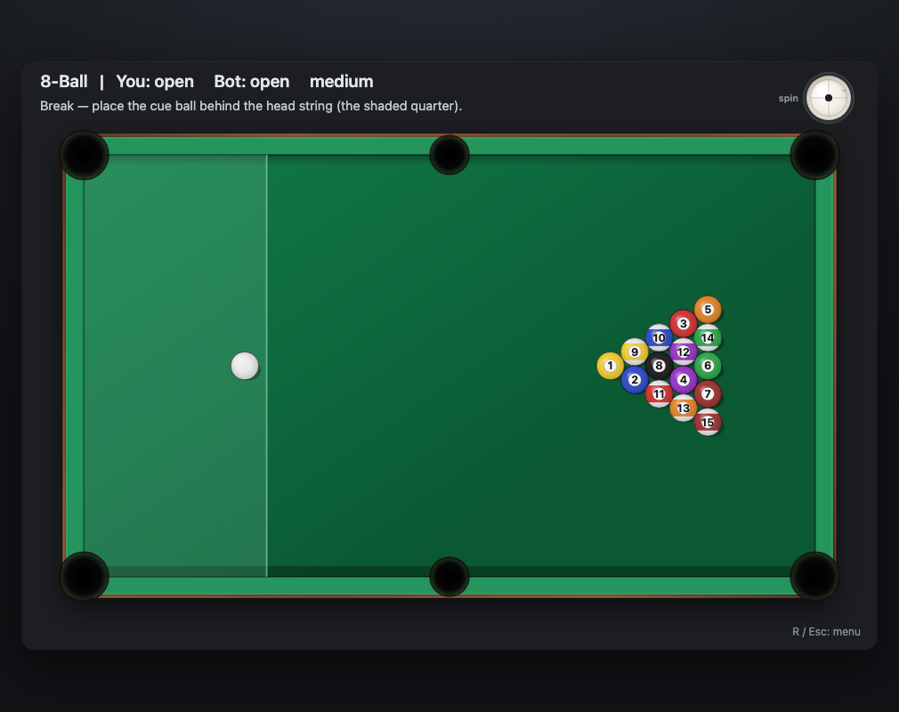
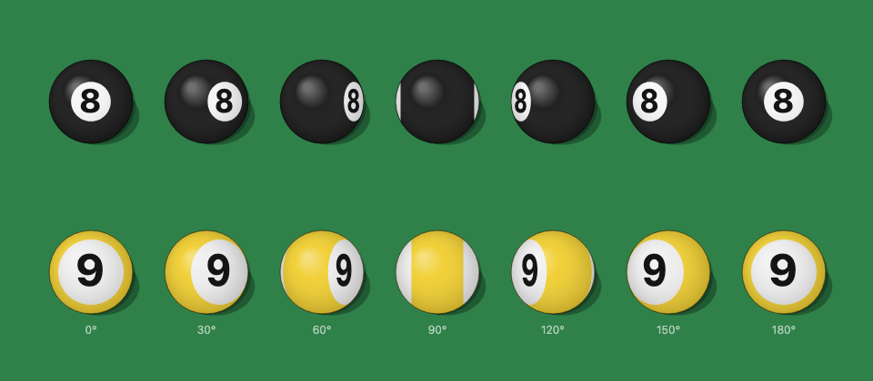
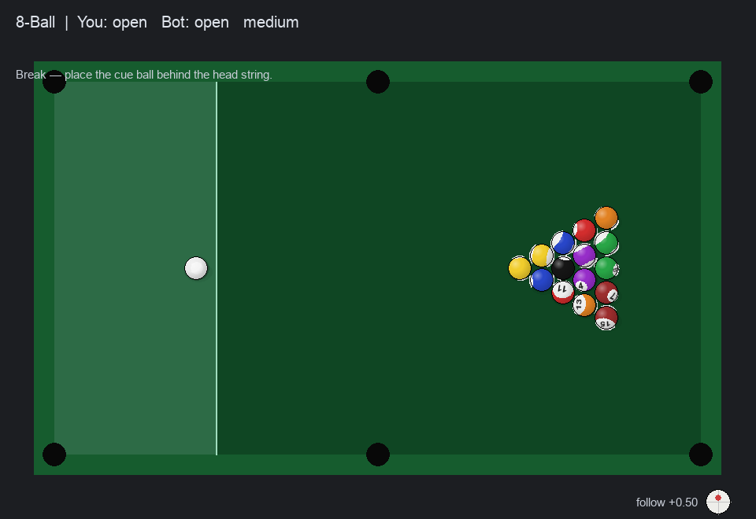

# Billiards-solo

Offline 8-ball & snooker vs-AI — as a **zero-dependency offline web page** *and* a pygame desktop app.

A reverse-engineering study of [bloob.io](https://bloob.io)'s human-vs-bot play: analyse the front end to
extract physics constants and bot heuristics, then **reimplement everything from scratch** (no obfuscated
source or art is copied).


## Play online

| Host | Link |
|---|---|
| GitHub Pages | <https://franky100-pig.github.io/Billiards-solo/> |
| WorkBuddy | <https://billiards-solo.app.workbuddy.host/> |

Both serve the same static build from `web/` — no backend, no cookies, no tracking.

## Play — offline web (recommended)

No install, no local server, no network:

1. Open **`web/index.html`** in any modern browser (double-click it).
2. Pick **8-BALL** or **SNOOKER** and a difficulty.
3. Play against the built-in bot.

| 8-Ball | Snooker |
|---|---|
|  |  |

Four presses of **↓** put the tip on the bottom of the dial — the dot sits at 6 o'clock and the stroke is a
draw. This is the same dial the stroke animation and the physics read, not a separate indicator:


The break has to come from behind the head string, so while you are picking a spot the legal quarter is
shaded and a click outside it is refused with an explanation:



### The balls roll; they do not slide

A ball carries a real orientation, integrated from its angular velocity, and the number and stripe are
painted onto that sphere — so what you see is the printing turning over the ball, not a flat sprite being
dragged across the cloth. The same two balls, one half-turn apart in 30° steps:



Because the rotation comes from the *angular* velocity and not from the distance travelled, the animation
says something true about the shot: a ball that is still skidding slides without turning, a draw shot keeps
turning backwards while it is still moving forwards, and side spin turns the print flat instead of
end-over-end.

Every ball carries its number on **both poles** — as real balls do — so a parked ball is never more than a
half turn from showing one, and it keeps whatever orientation it stopped in rather than snapping face-up.
What that costs is honest: when the patch has tipped past the horizon you see colour instead of a number
(about a fifth of resting object balls), and a numeral foreshortened past the point of legibility is
dropped rather than drawn as a smudge that misreads as a different digit. Colour and stripe identify every
ball in 8-ball on their own, so nothing is ambiguous.

### Controls
- **Ball-in-hand** — click/tap a clear spot to place the cue ball. After a foul that is anywhere on the
  table; **on the break it must be behind the head string**, so the legal quarter of the table is shaded
  until the ball is down. A refused spot says why.
- **Aim** — just move the cursor. The aim is the ray **from the cue ball to the pointer**, so the line,
  the ghost ball and the cue all point where you are looking. (Clicking is not what aims.)
- **Power** — press anywhere to **lock** that direction, then drag **back** along the cue and release. The
  shot only ever uses the backward component of the drag, so loading power cannot change where you are
  pointing; a sideways or forward drag loads nothing. **Right-click** puts a loaded cue back down.
- **English (加塞)** — click/drag inside the spin dial on the right, or walk the tip with **↑ ↓ ← →**
  (up = follow, down = draw, left/right = side spin; **Shift** = a fine 0.05 step). The tip cannot leave
  the ball: overshooting slides it along the rim. **S** or a double-click re-centres, and **every stroke
  resets the tip to dead centre on its own** — english is consumed by the shot it was dialled in for and
  can never leak into the next one. The cue itself is drawn off-centre, matching the strike point.
- **R / Esc** — back to the menu.

This is how bloob's own input works: its `power(start, end, angle)` helper throws the pull away unless it is
within 90° of the cue, which is exactly why aiming and loading are two separate gestures there. The pull is
gamma-shaped (`power = min + frac^1.35 · range`), so the first third of the drag is a soft touch and only the
last stretch reaches a full stroke. A live `POWER n%` bar makes it easy to judge.

### Pacing

The table runs in **real time**: a fixed 240 Hz integration step, 4 substeps per 60 Hz frame — i.e. exactly
1/60 s of table time per frame, no matter how fast the display refreshes. (The earlier build ran 16 steps of
1/360 s per frame, so every ball moved **2.7× faster than reality** and collisions were over before you could
read them.) The speeds that come out are the physical ones: a medium stroke is ~200–400 units/s, i.e.
0.35–0.7 table-lengths a second, and such a ball takes 3–4 s to run the length of the table and settle.
A hard break takes ~8 s to play itself out, which is about right for fifteen balls on two rails.

### Presentation


- **Rolling balls.** Each ball carries a roll angle (`dθ = ds / r`, so it turns exactly as far as it travels).
  The number patch and the snooker sheen slide and squash across the sphere as it turns, and disappear behind
  the horizon when the ball has rolled past them; a soft ball-coloured comet tail trails anything moving fast.
  When a ball settles, the pattern eases face-up so the number is always readable at rest.
- **The cue.** A drawn cue — rosewood butt, linen wrap, joint collar, maple shaft, ivory ferrule, chalked tip
  — sits off the cue ball, pulls back as you drag and snaps through the ball on release. Its thickness scales
  with the ball radius, and it is shortened if the butt would leave the canvas.
- **The shot line.** The cue-ball path to first contact, the **ghost ball** at that contact point, the object
  ball's line (clipped to the first ball or cushion in the way, and pulsing the pocket when it is lined up),
  and the cue ball's deflection afterwards — all from pure geometry, recomputed every frame.
- **Dropping into a pocket.** A potted ball is no longer deleted on the frame it is captured. It slides the
  last few units into the pocket, shrinks, fades, and disappears under a rim shadow clipped to the pocket
  mouth, while the pocket flashes a ripple and the cloth dims around it. Contact also sprays a short ring of
  spark dots at the impact point, so you can *see* which pair of balls touched and how hard.


### Why it really is offline
- Plain classic `<script>` tags (no ES modules), so opening the file via `file://` works — **no `http.server` needed**.
- No network requests, no accounts, no cookies, no `localStorage`.

## Desktop version (pygame)

The original desktop build keeps the identical logic in Python:

```bash
pip install -r requirements.txt
python src/main.py
```

Same menu, controls and rules as the web build — including the shaded kitchen while you place the cue ball
for the break:



## Layout

```
web/                     offline web page — Canvas 2D, zero dependencies
  index.html
  css/style.css
  js/physics.js          deterministic top-down physics (angular momentum, cloth slip, throw)
  js/rules8ball.js       8-ball state machine (groups, fouls, win/loss)
  js/rulesSnooker.js     snooker state machine (reds/colours, re-spot, scoring)
  js/bot.js              ghost-ball AI (path clearance + cloned-world simulation)
  js/app.js              Canvas UI (menu, aim, HUD, turn flow)
src/                     pygame desktop build (same logic in Python)
docs/REA_findings.md     reverse-engineering findings & modelling decisions
```

## How the AI works

**Pot search.** For every legal target ball × pocket it computes the **ghost-ball** contact point, checks
that both the cue→ghost and target→pocket paths are clear, simulates the shot on a clone of the world, and
scores the outcome.

**Position play (走位).** Every simulated candidate also reports where the **cue ball came to rest**. The bot
then scores that resting position by asking "is there a clean pot available from here?" — it re-runs the
ghost-ball check from the new cue position against the balls that will be *on* next (group-aware for 8-ball,
phase-aware for snooker). A pot that leaves a good angle gets a bonus; a pot that leaves the cue snookered
gets a **penalty**, so the bot prefers a slightly harder pot that keeps position.

**Escape shots.** When nothing can be potted (blocked line, i.e. snookered), it mirrors each target across
every cushion to build **one-rail bank/kick** lines, simulates them, and plays the one that legally contacts
the ball that is on. A plain safety is the last resort.

**Measured power, not maximum power.** The old heuristic (`360 + 5.5 × distance`) was roughly ten times too
hot, so almost every shot saturated the cap and the bot smashed everything. With per-second exponential
friction a ball coasts exactly `v₀ / k` units, so the stroke a shot actually needs follows from the geometry:

```
power = k · (d_cue→ghost + d_object→pocket / cos(cut)) + 40
```

Thin cuts need proportionally more cue speed because only the normal component transfers. The result is short
positional strokes for short pots and a full stroke only when the table demands one — a full 8-ball frame now
strokes between roughly 130 and 1000 units instead of pinning 1350, and the break is the one shot that is
deliberately fired hard (`BREAK_8BALL = 950`, `BREAK_SNOOKER = 520`).

Difficulty tiers change aim noise, search depth and power jitter. The physics is framework-agnostic, so the
whole bot runs headless (that is how it is verified).

## Standard snooker table

The snooker table is built to real proportions rather than bloob's 1.85:1 field:

| Item | Standard | In game |
|---|---|---|
| Playing surface | 3569 × 1778 mm (**2:1**) | 620 × 310 units |
| Baulk line | 737 mm from baulk cushion (**0.2065 L**) | same fraction |
| The D | 292 mm radius (**0.1636 W**) | same fraction |
| Blue / pink / black | centre / 0.75 L / 324 mm off the top cushion | 0.5 / 0.75 / 0.9092 L |
| Yellow, green, brown | corners + middle of the D | same |

Rendering is standard snooker too: mahogany body, lighter rubber cushion band, green baize with a cloth
sheen, baulk line + D, the six spots, corner pockets larger than the middles, and plain glossy unnumbered
balls in the real snooker colours (ivory cue ball).

## Physics & rules highlights

- Deterministic top-down 2D physics: circle-circle impulses, circle-segment cushion reflection, and
  **segment-based pocket capture** (so fast balls can't tunnel past a pocket). Fixed 1/240 s step, 2 contact
  passes per step, `I = ⅖ m r²`, restitution `0.93` ball-ball and `0.72` ball-cushion, speed damping
  `v *= 0.55 per second` (`DAMPING = 0.45`, the same figure bloob uses — see `docs/REA_findings.md`).
- Standard 8-ball: open table, group assignment, the meaningful foul set, premature-8 = loss, legal-8 = win.
- **The break is played from the kitchen.** The cue ball goes behind the head string (the quarter nearest the
  head rail); the quarter is shaded while you choose a spot, and a click past the line is refused with the
  reason spelled out instead of silently doing nothing. Ball-in-hand after a foul is anywhere on the table.
- **A stroke too soft to reach a cushion is a foul.** After contact either a ball must drop or something must
  reach a rail; if neither happens the shot was not legal and the table passes over with ball in hand. This is
  the standard answer to "I barely touched it", and it is why the bot now refuses to play such a shot (see
  below).
- Standard snooker: 15 reds + 6 colours, red→colour scoring, colour re-spotting, ascending end-game order,
  foul penalty = `max(4, value of ball first hit, value of ball potted)`.

The bot is held to the same rule. Before a candidate stroke is scored it re-simulates the shot, and if the
shot would leave everything short it raises the power 45 % at a time until a ball reaches a rail or drops.
A stroke that was made legal that way is not allowed to jitter back below that threshold, since the power
jitter that models a human touch would otherwise undo the fix. Measured over six bot-vs-bot frames, that took
the bot's soft-foul rate from 19 % of strokes to 4 % — the remainder come from the *aim* jitter thinning a
contact out, which is a miss a human would make too.

The desktop build got the same treatment, and checking it against the same measurement caught a port that had
never received the break fix: the pygame bot was still aiming at the **deepest** ball in the pack instead of
the nearest one, so on half of its breaks it walked its own cue ball through the rack and scratched. Aiming at
the apex fixed that, and over 97 bot strokes the desktop bot now plays **no** soft fouls at all and breaks
cleanly 11 times out of 12 (8–10 balls reaching a rail).

### Real angular momentum (draw / follow / throw)

bloob's own spin is cosmetic: the dial tweaks the contact material (`friction = 1 + 0.3·my`,
`restitution = .9 + .45·my`) and rotates the *cue ball's velocity* by `0.25·mx` radians once after the first
contact. Nothing ever gets an angular impulse, so a real draw shot is impossible there. This build replaces
it with the actual mechanics of a sphere on cloth:

- Every ball carries `(wx, wy)` — the rolling axis — plus `wz`, side spin about the vertical.
- The contact patch slips at `u = (vx − r·wy, vy + r·wx)`. While `u ≠ 0` the cloth applies Coulomb friction
  `a = μ_slip·g`, and the friction force also spins the ball up: the slip decays at `(1 + m r²/I) = 3.5×` the
  rate the linear velocity does. That factor is the whole reason a draw shot checks up and comes back.
- The strike point sets the spin directly: for tip offset `h` (fraction of the ball radius) at cue speed `v`,
  `w = 2.5·h·v/r`. `h = 0` is a stun, `h = 0.4` is natural roll, and `h < 0` is back-spin.
- Ball-ball contact applies a tangential friction impulse (`μ_ball = 0.055`), so a cut shot **throws** the
  object ball off the geometric line and a spinning cue ball is deflected by the throw it imparts.
- Cushions apply a tangential impulse too (`μ_cushion = 0.17`), so side spin bends the rebound angle instead
  of being decoration, and `wz` bleeds off as the ball runs along the rail.
- A ball is only parked when its **speed and its slip** are both small, so a stationary-looking ball with
  back-spin left still bites and rolls back.
- The ball also carries a **unit quaternion** integrated from `(wx, wy, wz)` every step, so the picture is
  driven by the same rotation the mechanics use. It is presentation state — the rules and the bot never read
  it, and the bot's throwaway worlds switch the integration off (`clone()`), which is what keeps the search
  as fast as it was: without that switch the extra quaternion work doubled the bot's think time.

> **Modelling note (playability):** bloob's literal `hole.radius` (5 / 11) is smaller than the ball, so a
> shot aimed at a pocket would miss. Capture radius is relaxed to **1.5× ball radius**. The damping model is
> not a guess any more: the real engine chunk (`PoolScene-*.js`) turned out to be statically reachable, and
> its `applyDamping` is Matter's `v *= (1 − d)^dt` at 240 Hz — which is exactly the per-second
> `v *= exp(−0.45·t)` used here. Both decisions are documented in `physics.py` / `docs/REA_findings.md` §9.

## Fixed while porting to the web

The JavaScript port surfaced three genuine bugs that also affected the Python build; all are fixed in both:

1. **Balls could leave the table.** A fast ball could thread a sliver of a corner-pocket gap (gap diagonal
   slightly exceeds the capture radius), then fly off to infinity — simulations never settled. A hard
   containment safety net now captures out-of-bounds balls near a pocket and clamps/bounces anything else.
2. **The snooker cue ball started on the brown spot**, overlapping it and blocking every pot. The cue now
   starts offset inside the D.
3. **The red triangle was inverted**, so its wide back row overlapped the blue ball. The apex now faces the
   baulk end and the pack widens toward black.

## Verification

- **Physics & logic (Node, headless): 46/46** — the table settles; rolling advances exactly with travel; a
  full 8-ball frame completes; **no ball ever leaves the table**; the bot's strokes stay inside the power
  envelope and average well below the cap; snooker reds decrement consistently; colours pot in ascending
  order. Plus the new mechanics: a back-spin stroke **draws back**, a top-spin stroke **follows through**, a
  stun stops dead, side spin **throws** the object ball off line and **bends** the cushion rebound, and a
  coasting ball's speed follows `v₀·e^(−0.45 t)` to within a few per cent.
- **Position play & escapes (Node, headless): 6/6** — a deliberately snookered cue finds a one-rail kick that
  contacts the ball on, stays on the table, and the 8-ball / snooker frames still finish.
- **UI wiring (headless DOM/Canvas): 79/79** — menu → start → place → aim → pull → strike → resolve → bot
  turn, for both modes, plus the game-over overlay, a monotonic power curve from a soft tap to a full stroke,
  the spin dial setting the strike point, and ball-in-hand on both tables. The aim/power split has its own
  cases: pointing right aims right (not left), pointing up aims up, jitter sitting on the ball is ignored,
  pressing does not move the aim, the aim is identical before and after a full pull, and sideways/forward
  drags load exactly zero power.
- **Keyboard english (same suite)** — ↑ adds exactly one follow step and no side spin, ↓ undoes it to the
  bit, shift is a five-times finer step, twenty presses of ↑ park the tip at 12 o'clock and never off the
  ball, coming off the rim stays on the rim, arrows are prevented from scrolling the page and are inert
  while the balls roll, S re-centres, and **a stroke leaves the dial at dead centre**. End-to-end: the same
  shot fired from the centre and after five ↓ differ *only* in spin — the centre ball leaves with no rolling
  spin at all, the down-arrow ball leaves with a real backspin, and both settle without anything leaving the
  table.
- **Rules (in the 46 above)** — a spot past the head string is refused on the break and the same click
  inside the kitchen is accepted, with the centre allowed to sit exactly on the line and one unit past it
  not; ball-in-hand is unrestricted once the break is over; an overlapping ball is refused with a reason. On
  an empty table, a stroke that touches a ball and dies without reaching a cushion is a foul
  (`NO_CUSHION_AFTER_CONTACT`) with ball in hand to the opponent, the same stroke at pace is legal, and a
  ball potted with no rail contact at all is still legal.
- **Rolling print (same suite)** — a face-up ball prints its number in the middle of the ball; rolling it
  moves the number toward the leading edge (not backwards); a number at the horizon is not drawn at all; a
  steeply tipped number is still drawn and is still a legible shape rather than a sliver; a number past the
  sliver is dropped instead of garbled; and the far pole prints its own number, upright and unmirrored.
  Backed by an offline check of the cap outline against the analytic membership test
  `p·a₂ + √(1−|p|²)·a_z ≥ c` over 70 965 probe points across every orientation: **0.05 % mismatch**, all of
  them on the boundary itself — and by a sweep of the same ball at every angle, which is where the
  foreshortening floor came from.
- **Pygame build (same rules)** — the identical scenarios run against `src/`: head string, refusal message,
  and both the soft and the hard stroke, plus a headless `SDL_VIDEODRIVER=dummy` render of the break frame.
- Screenshots above are real renders captured with headless Chrome.

The bot search is a **generator** that is drained in ~7 ms slices per frame, so choosing a shot never freezes
the page — the bot "thinks" while the table keeps rendering.

## Scope / progress

- [x] Repo & offline skeleton
- [x] REA recon + static analysis (`docs/REA_findings.md`)
- [x] Physics engine (Python + JS)
- [x] 8-ball rules + AI
- [x] Snooker rules + AI
- [x] pygame desktop UI
- [x] **Zero-dependency offline web build (Canvas 2D)**
- [x] Standard-proportion snooker table, markings and ball set
- [x] Bot position play (走位) + one-rail escape shots
- [x] Rolling-ball animation, drawn cue and the full aiming aid
- [x] Measured bot power (no more "everything at maximum")
- [x] **True angular momentum physics** — draw, follow, stun, throw and spin-bent cushions
- [x] **Real-time pacing** (240 Hz, exactly 1/60 s per frame) and a clickable english dial
- [x] Pocket-drop animation, contact sparks and pocket ripples
- [x] Offline verification: 8-ball and snooker can be played to completion
- [x] Hosted copies: GitHub Pages & WorkBuddy

## Disclaimer

Learning / engineering exercise. Gameplay inspiration comes from bloob.io (Kinglet Code, closed source);
**all code here is independently rewritten** and contains no bloob proprietary source or art.

---

## 中文简介

离线八球 / 斯诺克人机对战。现在提供**零依赖离线网页**：直接双击 `web/index.html` 即可在浏览器里玩，
无需安装、无需本地服务器、全程无网络。原有 `src/`（Python + pygame）桌面版逻辑完全一致，保留可用。
斯诺克台面按**标准 2:1 比例**重建（开球线 0.2065L、D 区半径 0.1636W、粉球 0.75L、黑球 0.9092L），
配木质台身、绿色台呢、开球线与 D 区、六个点位、角袋大于中袋、无色号的高光球体。
bot 除 ghost-ball 进球搜索外，新增**走位评估**（打完球后母球是否还有清晰下一杆）与**一库解球**救球，
被斯诺克时不再直接犯规。逆向结论、建模决策与移植中修复的 bug 见上文与 `docs/REA_findings.md`。

**画面**：球会真的滚（号码盘随滚动滑移、压扁、转到背面消失，停下时自动转正），快速移动带拖影；
球杆是完整的（紫檀后把、线缠、接牙、枫木前节、白铜先角、巧克杆头），拉杆时后撤、出杆时抽送；
瞄准辅助给出母球路径、假想球、目标球预测线（遇到球或库边就截断，正对袋口时袋口脉冲）和母球分离线。

**力度**：bot 不再"每杆最大力"。指数摩擦下球滑行距离恰为 `v₀/k`，于是所需速度可由几何直接算出
`power = k·(母球到假想球距离 + 目标球到袋距离 / cos(切角))`，薄球按法向分量补偿。实测一整局 8 球
力度落在 ~130–1000（上限 1350），只有开球是刻意发力。

**瞄准与发力分开**（和 bloob 一样）：鼠标移动就决定方向——瞄准线是**母球到鼠标的射线**，球杆、假想球、
预测线全都指向你看着的地方；按下只是**锁定**这个方向，之后往回拖才拉杆蓄力。蓄力只取"沿球杆往回"的那
一个分量，所以拉多大力都改不了方向，横着拖、往前拖都是 0，右键把拉满的杆放回去。gamma 曲线让前 1/3
是轻推、后段才到满杆，并实时显示 `POWER n%`。

**节奏**：台面现在按**真实时间**跑——固定 240 Hz 积分步长、每帧 4 个子步，也就是每帧恰好推进 1/60 秒
的台面时间。旧版本每帧跑 16 个 1/360 秒的步，等于所有球**快 2.7 倍**，碰撞在看清之前就结束了，这就是
"基础速度太快、反应不过来"的根因。

**碰撞**：每颗球都带真正的角速度（`wx, wy` 滚动轴 + `wz` 侧旋）。接触点打滑时台呢给的是库仑摩擦，
摩擦力同时把球"转"起来，所以滑移衰减比线速度衰减快 `1 + mr²/I = 3.5` 倍——这正是低杆能缩回来、高杆
能跟进的原因。球球接触带切向摩擦冲量（`μ = 0.055`），所以切球会**甩**目标球（throw），带旋的母球也会
被甩偏；库边同样有切向冲量（`μ = 0.17`），侧旋会真的改变反弹角，而不是装饰。球只有在**速度和滑移都
很小**时才会停下，所以"看着不动但还有后旋"的球会继续咬地往回滚。

**规则**：开球必须从**头线后面**打——母球要放在靠头库那一/四区（"厨房"）里，选位时这块区域会淡绿高亮，
点到线外会被拒绝并直接告诉你原因，而不是"点了没反应"。犯规后的自由球可以放在台面任意位置。
另一条按标准规则补上的是**击球过轻**：接触目标球之后，必须要么有球进袋、要么有球碰到库边，两样都没有
就是犯规，把台面交给对手。这条以前缺失，所以"轻轻一碰"不会受罚。机器人也被这条规则约束——它在给
候选杆打分前会重新模拟一遍，如果这一杆打完谁都没碰库，就把力度按 45% 递增加码，直到有球碰库或进袋；
这样加过力的杆不会因为模拟人手抖动的随机衰减而退回不合格的力度。实测（6 局机器人对局）这条把机器人的
"过轻犯规"从 19% 压到 4%，剩下的来自瞄准抖动把接触打薄，属于真人也会犯的失误。

桌面版也照同一条规则改，而拿同一套测量去核对时直接抓出一个从没同步过的 bug：pygame 机器人开球时瞄的是
球堆**最里面**那颗，而不是最近的那颗，结果一半的开球母球直接穿过球堆、摔袋。改瞄顶点之后，97 杆里**一次
过轻犯规都没有**，12 次开球有 11 次干净（8–10 颗球碰库）。

**加塞**：右侧旋钮点一下就把击球点挪过去，拖到下面是**低杆**、上面是**高杆**、左右是**侧塞**；也可以
直接用 **↑ ↓ ← →** 一格一格走（每格 0.2 个球半径，按住 **Shift** 变成 0.05 的细调）。击球点不会走出球
体——越界会被投影回圆周上，所以一直按住 ↑ 会稳稳停在 12 点方向，而不是乱跳。双击旋钮或按 **S** 回中；
**每打完一杆都会自动回到正中心**，这杆调的塞不会被带到下一杆去。球杆画出来时也会偏离球心，和击球点
一致。击球点偏移 `h` 直接决定角速度 `w = 2.5·h·v/r`：正中心是定杆，往下四格就是真低杆。

**滚动**：球不是贴图在平移，而是带着真实朝向在转——母球/目标球都维护一个单位四元数，每一步由
`(wx, wy, wz)` 积分，号码和条带是"印在球面上"再投影出来的。所以号码会沿着球面翻过去、在边缘被压扁、
翻到背面就看不见；条纹也会跟着转，而不是永远横在球中间。因为转向来自**角速度**而不是走了多远，
动画本身是有信息的：还在打滑的球只平移不转，低杆球一边往前一边**倒着转**，侧塞则是绕竖轴平转。
停下来的球保持它停住时的朝向——每颗球两面都印号（和真球一样），所以最多半个身子转过去就能再看到号码，
而不是靠"停球时把角度归零"这种作弊。代价是诚实的：贴片翻过地平线时就只剩颜色（约五分之一的静止目标球），
而压扁到已经读不出来的号码宁可不画——否则 8 会被看成 0、12 会被看成 (2，那是更糟的错。
八球里颜色 + 花色本来就足以认出每一颗球。

**进袋**：进袋不再"一帧消失"。球会滑进袋口最后几个单位、缩小、淡出，并在一道裁剪到袋口的袋沿阴影下
消失，同时袋口泛起涟漪、附近台呢变暗；碰撞点还会溅出一圈短促的火花点，能看清是哪两颗球撞了、多重。

> 顺带一提：bloob 自己的加塞是"假"的——旋钮只改接触材质（`friction = 1 + 0.3·my`、
> `restitution = .9 + .45·my`），`mx` 只在第一次接触后把母球**速度**转 `0.25·mx` 弧度一次，全程没有任何
> 角冲量，所以它做不出真正的低杆。这里换成了真角动量（详见 `docs/REA_findings.md` §9、§11）。

---

MIT License © 2026 Franky100-pig
